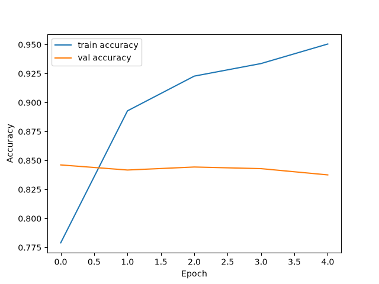
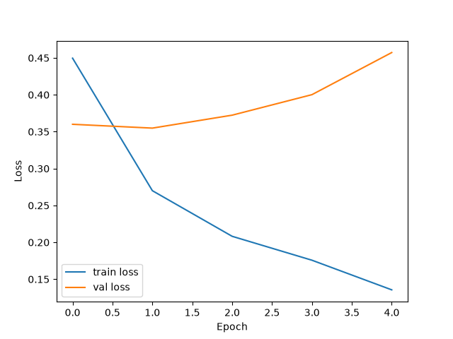

# IMDB Movie Review Sentiment Analysis using LSTM

A deep learning model built with TensorFlow/Keras that reads a movie review and predicts whether it is **positive** or **negative**.

## Dataset

- **IMDB movie reviews** dataset (built into Keras, downloaded automatically on first run)
- 25,000 training reviews and 25,000 test reviews
- Labels: `0` = negative, `1` = positive
- Only the 10,000 most frequent words are kept (vocabulary size = 10,000)
- Every review is padded or truncated to exactly 100 words

## Model Architecture

| Layer | Details | Output shape |
|---|---|---|
| Input | 100 word IDs per review | (100,) |
| Embedding | 10,000 words, each word -> 32 numbers | (100, 32) |
| LSTM | 32 units | (32,) |
| Dense | 1 neuron, Sigmoid | (1,) |

- Total parameters: 328,353 (Embedding 320,000 + LSTM 8,320 + Dense 33)
- Optimizer: Adam
- Loss: Binary Crossentropy
- Epochs: 5, batch size: 64
- Validation split: 20% of the training data (20,000 train / 5,000 validation)

## Results

**Test accuracy: 83.1 %** on 25,000 unseen reviews.

| Class | Precision | Recall | F1-score | Support |
|---|---|---|---|---|
| Negative | 0.81 | 0.86 | 0.84 | 12,500 |
| Positive | 0.85 | 0.80 | 0.83 | 12,500 |

**Confusion Matrix**

|  | Predicted negative | Predicted positive |
|---|---|---|
| **Actual negative** | 10,773 | 1,727 |
| **Actual positive** | 2,487 | 10,013 |

### Training curves




### Observation: overfitting

Training accuracy kept rising (78% to 95%) while validation accuracy stayed around 84%. Validation loss was lowest at epoch 2 and then increased. This means the model starts to memorize the training reviews after the first few epochs, so training for more epochs would not help without techniques such as Dropout or Early Stopping.

## Tech Stack

Python, TensorFlow/Keras, NumPy, scikit-learn, Matplotlib

## How to Run

1. Clone the repository
2. Install the libraries:
   ```
   pip install -r requirements.txt
   ```
3. Run the script (the IMDB dataset downloads automatically the first time):
   ```
   python imdb_lstm_classification.py
   ```

## What I Learned

- Why text must be converted to numbers: vocabulary, word IDs, padding
- How an Embedding layer turns each word ID into a vector of 32 numbers
- How an LSTM reads a review word by word and keeps a memory of earlier words
- How to read train vs validation curves to detect overfitting
- How to evaluate a classifier with a Confusion Matrix and Classification Report

## Author

`<Your Name>` | `<GitHub / LinkedIn link>`
